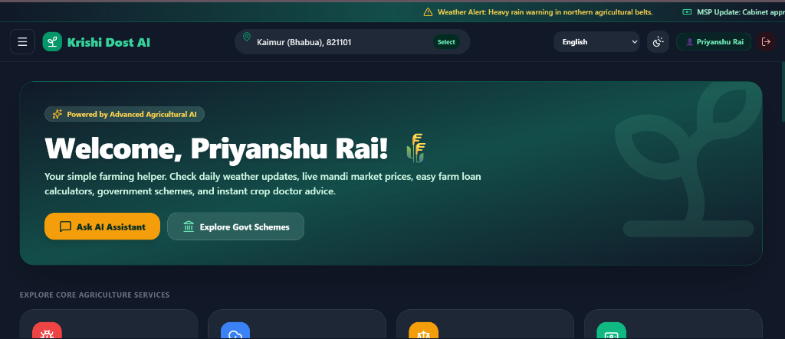
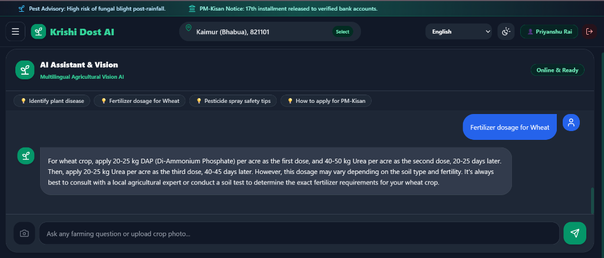
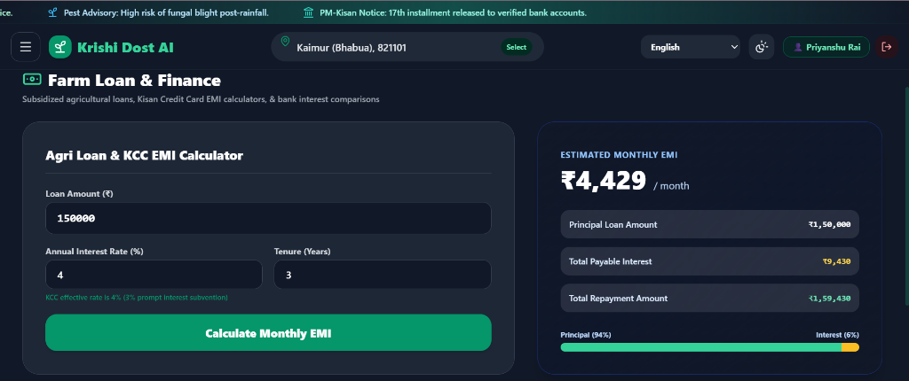
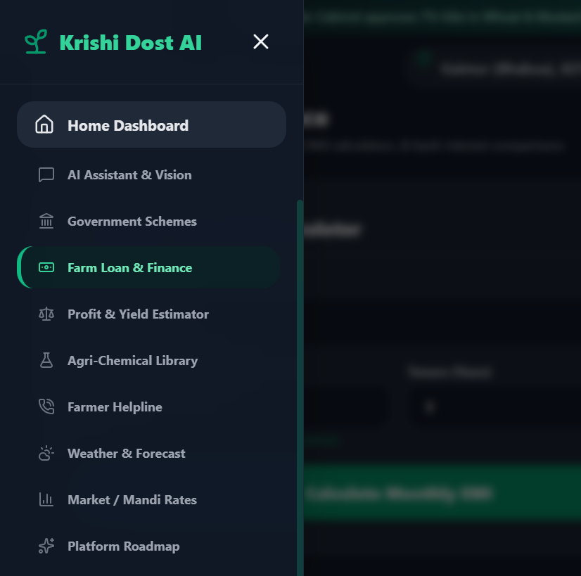

# 🌾 Krishi Dost AI (कृषि दोस्त AI)
> **Empowering 140+ Million Indian Farmers with Next-Gen Artificial Intelligence & Business Intelligence Decision Analytics**

[](https://krishi-dost-ai.vercel.app/)
[](https://github.com/priyanshurai10/Krishi-Dost-Ai)
[](krishi_dost_ai_model.py)
[](docs/Krishi_Dost_AI_Project_Report.docx)

[](https://vitejs.dev/)
[](https://nodejs.org/)
[](https://groq.com/)
[](LICENSE)

🌐 **Official Live Web Application**: [https://krishi-dost-ai.vercel.app/](https://krishi-dost-ai.vercel.app/)

**Krishi Dost AI** is an all-in-one digital agriculture platform designed specifically for Indian farmers. It bridges traditional farming and modern data science by converting raw agricultural data into actionable business intelligence. It integrates real-time meteorological advisories, live Mandi commodity prices, AI-driven crop leaf disease diagnosis, predictive crop yield forecasting, day-by-day crop calendars, digital soil health cards, and subsidized Kisan Credit Card (KCC) loan calculators into a clean, modern web application.

---

## 🔗 Live Links & Deliverables

- **🌐 Live Production Website**: [https://krishi-dost-ai.vercel.app/](https://krishi-dost-ai.vercel.app/)
- **💻 GitHub Source Repository**: [https://github.com/priyanshurai10/Krishi-Dost-Ai](https://github.com/priyanshurai10/Krishi-Dost-Ai)
- **⚡ Backend Service API**: [https://krishi-dost-backend.onrender.com](https://krishi-dost-backend.onrender.com)
- **📊 Dataset Source**: [Indian Agriculture Crop Production & Yield Dataset (Kaggle)](https://www.kaggle.com/datasets/thedevastator/crop-yield-prediction-dataset)
- **📄 Final Project Report (Word .docx)**: [`docs/Krishi_Dost_AI_Project_Report.docx`](docs/Krishi_Dost_AI_Project_Report.docx)
- **📝 Final Project Report (Markdown)**: [`docs/Krishi_Dost_AI_Project_Report.md`](docs/Krishi_Dost_AI_Project_Report.md)
- **🤖 Standalone ML Script**: [`krishi_dost_ai_model.py`](krishi_dost_ai_model.py)
- **📦 Python Dependencies**: [`requirements.txt`](requirements.txt)

---

## ✨ Key Features & New Additions

### 1. 📈 AI Crop Yield & Harvest Predictor (NEW)
- Machine-learning driven yield prediction engine based on Crop type, Soil type, Sowing Season, Land Size, Irrigation Method, and Fertilizer Dosage.
- Calculates **Predicted Harvest (Quintals/Acre + Total)**, comparison with district benchmarks, projected **Net Profit**, and **Climate Vulnerability Risk**.

### 2. 📅 Smart Day-by-Day Crop Calendar & Checklist (NEW)
- Generates a tailored 120–150 day phase-by-phase schedule starting from the farmer's sowing date.
- Real-time days-since-sowing counter, active phase highlight (e.g. CRI at 21–25 days), and an interactive task checklist persisted in local storage.

### 3. 🧪 Soil Health Card & Precision NPK Calculator (NEW)
- Evaluates soil test values: Available Nitrogen (N), Phosphorus (P), Potassium (K), Soil pH (5.0–9.0), and Organic Carbon %.
- Computes an **Overall Soil Index (0–100)** and outputs exact fertilizer prescriptions in **50kg bags of Urea, DAP, and MOP**, plus micronutrient and organic manuring guidelines.

### 4. 🎙️ Voice Assistant (Speech-to-Text & Text-to-Speech) (NEW)
- **Voice Query**: Farmers can tap the 🎙️ **Microphone** to ask questions naturally in Hindi or English using browser Web Speech API.
- **Audio Advice**: Farmers can tap the 🔊 **Listen Advice** button on any AI recommendation to hear it read aloud.

### 5. 🏛️ 5-Level Business Intelligence Decision Dashboard (NEW)
- Built directly on the executive BI methodology:
  - **Level 1 (KPIs)**: Farm Productivity Index (94.2%), Net Margin (48.6%), Cost of Cultivation (₹13,850/acre), Resource Efficiency (91/100).
  - **Level 2 (Trends)**: Multi-season yield and Mandi price trajectories over 3 years.
  - **Level 3 (Drivers)**: Production cost drivers (Fertilizer 28%, Machinery 22%, Labour 20%, Seeds 16%, Irrigation 14%).
  - **Level 4 (Risks & Opportunities)**: Late February heat wave risk mitigation vs. high-margin Mustard rotation (+18% profit surge).
  - **Level 5 (Actions)**: Prioritized strategic recommendations.

### 6. 🌿 Multilingual Crop Health Vision AI Doctor
- Detects leaf blight, yellow rust, and stem borers from user-uploaded plant photos.
- Powered by Groq `llama-3.3-70b-versatile` with strict language-matching (Hindi, Hinglish, English, Bengali, Marathi, Punjabi, Tamil, Telugu, Gujarati).

### 7. 💳 Kisan Credit Card (KCC) 4% Subsidized Loan Calculator
- Calculates monthly EMI under government subsidized **4% effective interest rate** (with prompt 3% interest subvention).

### 8. 🌦️ Smart Weather & Pincode Locator
- Live temperature, rainfall probability, humidity, and agronomic spraying advisories linked to all 36 Indian States/UTs and 6-digit Pincodes.

---

## 📸 Screen Showcase

### 1. 🏡 Home Dashboard View


### 2. 🤖 AI Assistant & Crop Health Vision (Voice Enabled)


### 3. 💳 Farm Loan & Finance Calculator (KCC 4%)


### 4. 📱 Collapsible Navigation Drawer


---

## 🛠️ Technology Stack

- **Frontend Framework**: React 19 + Vite 8
- **Styling**: Tailwind CSS + Custom Glassmorphic Tokens
- **Icons**: Lucide Icons
- **Backend Runtime**: Node.js + Express.js
- **Machine Learning**: Python 3, scikit-learn, Random Forest, Gradient Boosting
- **AI Infrastructure**: Groq Cloud (`llama-3.3-70b-versatile`)
- **Speech Engine**: Web Speech API (`SpeechRecognition` & `SpeechSynthesis`)
- **Weather & Geo**: Open-Meteo Weather Forecast API + All-India Pincode Dataset

---

## 🚀 Quick Setup & Installation Guide

### Prerequisites
- Node.js (v18 or higher)
- Python (v3.10 or higher)
- npm or yarn

### 1. Clone Repository
```bash
git clone https://github.com/priyanshurai10/Krishi-Dost-Ai.git
cd Krishi-Dost-Ai
```

### 2. Run Standalone Python ML Model
```bash
pip install -r requirements.txt
python krishi_dost_ai_model.py
```

### 3. Backend Setup
```bash
cd backend
npm install
```
Create a `.env` file inside `backend/`:
```env
PORT=5000
GROQ_API_KEY=your_groq_api_key_here
```
Start backend:
```bash
node server.js
```

### 4. Frontend Setup
```bash
cd ../frontend
npm install
npm run dev
```
Open **`http://localhost:5173/`** or visit the live app at **`https://krishi-dost-ai.vercel.app/`**.

---

## 👨‍💻 Developer & Author Profile

Designed & Developed by **Priyanshu Rai**:

- **🌐 Live Production Website**: [krishi-dost-ai.vercel.app](https://krishi-dost-ai.vercel.app/)
- **💻 GitHub Source Repository**: [github.com/priyanshurai10/Krishi-Dost-Ai](https://github.com/priyanshurai10/Krishi-Dost-Ai)
- **🐙 GitHub Profile**: [github.com/priyanshurai10](https://github.com/priyanshurai10)
- **💼 LinkedIn Profile**: [linkedin.com/in/priyanshu-rai-2114722ab](https://linkedin.com/in/priyanshu-rai-2114722ab)
- **🚀 Personal Portfolio**: [priyanshurai-portfolio.vercel.app](https://priyanshurai-portfolio.vercel.app/)

---

## 📜 License
This project is licensed under the MIT License - see the [LICENSE](LICENSE) file for details.
