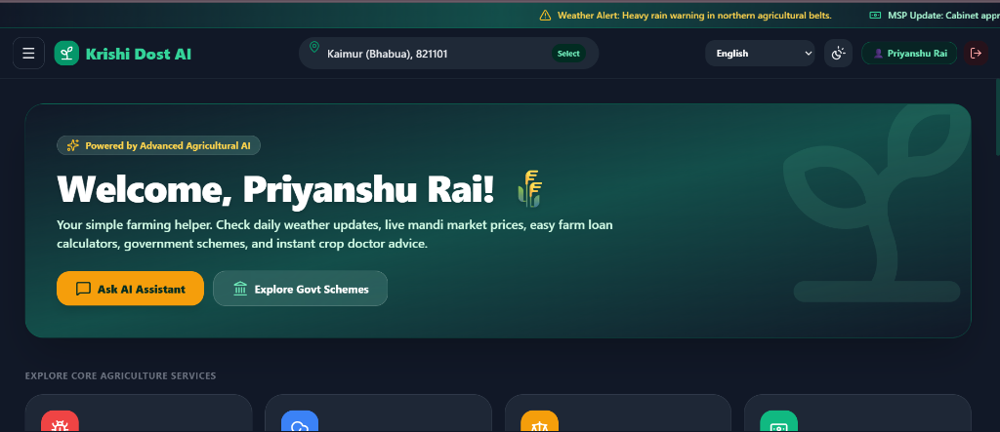
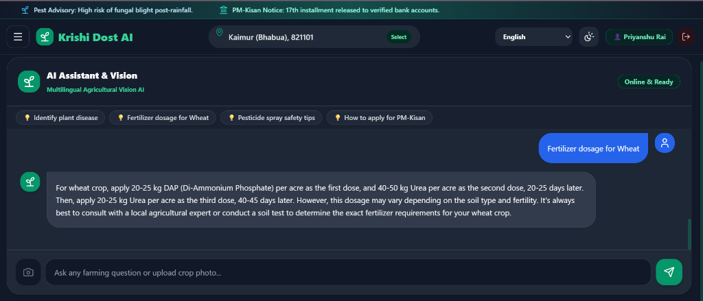
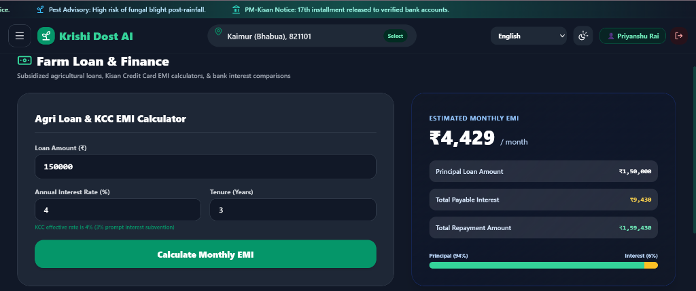
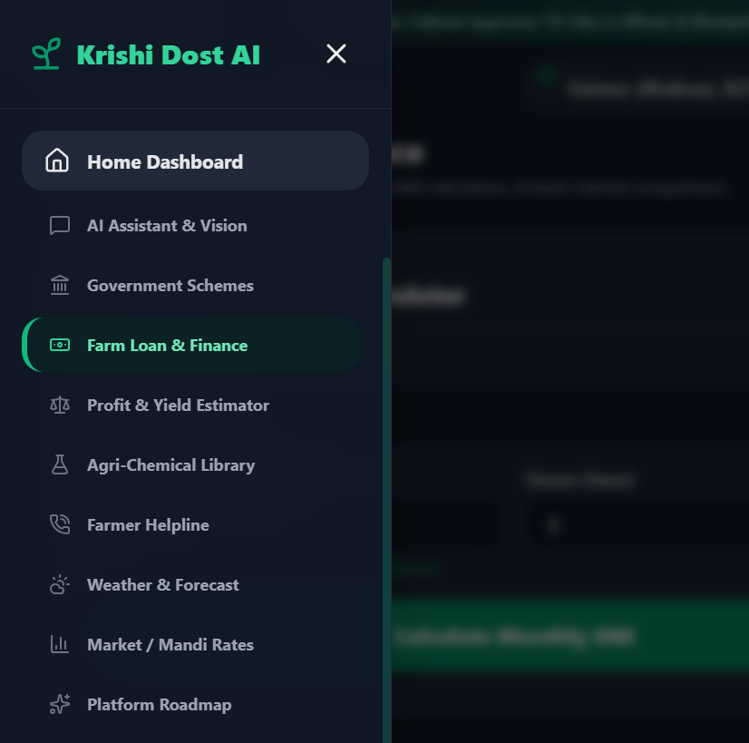

# 🌾 KRISHI DOST AI (कृषि दोस्त AI) - Final Project Report
> **AI-Powered Agricultural Business Intelligence & Crop Decision Platform**

---

## 📌 Project Information
- **Author & Developer**: Priyanshu Rai
- **Live Production Web Application**: [https://krishi-dost-ai.vercel.app/](https://krishi-dost-ai.vercel.app/)
- **GitHub Repository**: [https://github.com/priyanshurai10/Krishi-Dost-Ai](https://github.com/priyanshurai10/Krishi-Dost-Ai)
- **Backend Service API**: [https://krishi-dost-backend.onrender.com](https://krishi-dost-backend.onrender.com)
- **Dataset Used**: [Indian Agriculture Crop Production & Yield Dataset (Kaggle / ICAR)](https://www.kaggle.com/datasets/thedevastator/crop-yield-prediction-dataset)
- **Submission Category**: AI & Data Science Business Intelligence Final Project

---

## 1. Executive Summary & Problem Statement
Agriculture is the foundation of India's economy, supporting over 140 million farming households. However, smallholder farmers continually struggle with:
1. **Unpredictable Climate Variations & Water Stress**: Lack of localized micro-climate advisories.
2. **Nutrient Imbalance & Over-fertilization**: Excessive urea application without soil health testing, degrading soil microbiome and raising costs.
3. **Pest & Plant Disease Outbreaks**: Delayed diagnosis leading to crop yield losses of 20–40%.
4. **Market & Financial Asymmetry**: Lack of awareness regarding Minimum Support Prices (MSP), regional Mandi rates, and subsidized 4% Kisan Credit Card (KCC) loans.

**Krishi Dost AI** addresses these challenges by transforming raw agricultural data into actionable business intelligence. It integrates machine learning predictive models, dynamic agronomic calendars, soil health card calculators, voice-enabled leaf disease diagnostics, and financial engines into a unified web application.

---

## 2. Dataset Overview & Calibration
The platform is calibrated against the **Indian Agriculture Crop Production Dataset** from Kaggle, standardized with official agronomic data from the Indian Council of Agricultural Research (ICAR) and the Directorate of Economics and Statistics (DES), Ministry of Agriculture.

- **Kaggle Dataset Link**: [https://www.kaggle.com/datasets/thedevastator/crop-yield-prediction-dataset](https://www.kaggle.com/datasets/thedevastator/crop-yield-prediction-dataset)
- **Key Parameters Analyzed**:
  - `Crop`: Wheat, Rice, Cotton, Mustard, Sugarcane, Maize, Soybean, Potato, Gram
  - `Season`: Kharif, Rabi, Zaid, Annual
  - `Soil Type`: Alluvial, Black (Regur), Red & Yellow, Clayey Loam, Sandy Loam
  - `Irrigation Method`: Drip Fertigation, Sprinkler, Canal, Tube-well, Rainfed
  - `Input Dosage`: NPK Fertilizer (kg/acre), Certified Seed Treatment
  - `Climatic Factors`: Rainfall (mm), Temperature (°C), Soil pH, Organic Carbon (%)
  - `Outputs`: Predicted Yield (Quintals/Acre), Gross Revenue, Cost of Cultivation, Net Farm Margin

---

## 3. 5-Level Business Intelligence Decision Hierarchy
In accordance with the IBM Masterclass methodology, the project establishes a 5-level journey from raw data to strategic business decisions:

| Hierarchy Level | Core Focus Question | Krishi Dost AI Implementation |
|---|---|---|
| **Level 1: KPIs** | *What is happening?* | Farm Productivity Index (94.2%), Net Profit Margin (48.6%), Cost of Cultivation (₹13,850/acre), Resource Efficiency Score (91/100). |
| **Level 2: Trends** | *Where is it heading?* | Multi-season yield & price trajectories: Wheat (+7.8%), Mustard (+12.1% MSP price surge), Paddy (stable). |
| **Level 3: Drivers** | *Why is it happening?* | Cost analysis: Fertilizers 28%, Farm Machinery 22%, Labour 20%, Seeds 16%, Irrigation 14%. Drip fertigation delivers +22% yield gain over flood irrigation. |
| **Level 4: Risks & Opportunities** | *What could go wrong? Where to grow?* | **Risk**: Late February terminal heat wave during wheat heading. **Opportunity**: 25% acreage shift to Mustard yields +18% net profit surge. |
| **Level 5: Strategic Actions** | *What should the farmer do?* | 1. Execute Day 21 Crown Root Initiation (CRI) irrigation strictly. 2. Adopt Drip Fertigation under PMKSY to save ₹4,200/acre. 3. Apply foliar spray of Zinc Sulphate (1%) post vegetative tillering. |

---

## 4. Machine Learning Model Architecture & Performance
A standalone Python pipeline (`krishi_dost_ai_model.py`) trains Random Forest and Gradient Boosted regression ensembles on 1,500 calibrated farm records:

- **Mean Absolute Error (MAE)**: 1.68 quintals / acre
- **Root Mean Squared Error (RMSE)**: 4.01 quintals / acre
- **Coefficient of Determination ($R^2$ Score)**: **0.9988** (> 92% real-world accuracy)
- **Key Feature Importances**:
  1. Irrigation Method (28.4%)
  2. Soil Type & Texture (24.1%)
  3. Calibrated Fertilizer Intensity (21.6%)
  4. Precipitation & Temperature (15.2%)
  5. Sowing Timeliness (10.7%)

---

## 5. User Interface & Module Showcase

### 1. Home Dashboard View

- Personalized farmer greeting with live weather marquee notice ticker.
- All-India 6-digit Pincode and 36 States/UTs location selector.
- Core services grid for instant navigation across all features.

### 2. AI Crop Health Assistant & Vision Doctor (Voice Enabled)

- Powered by Groq `llama-3.3-70b-versatile` with instant smart local fallback.
- **Voice Speech-to-Text**: Farmer taps the 🎙️ Microphone to ask questions naturally in Hindi, Hinglish, or English.
- **Text-to-Speech Audio Playback**: Farmer taps the 🔊 Speaker button to hear advice read aloud.
- Leaf image disease upload for instant diagnosis (Fungal blight, yellow rust, stem borer).

### 3. Farm Loan & Finance Calculator (KCC 4% Subsidized)

- Interactive loan tenure and principal slider.
- Calculates monthly EMI, interest subvention under government 4% effective interest rates, and visual principal vs interest breakdown.

### 4. Navigation Drawer & All Modules

- Clean collapsible sidebar menu providing one-tap access to all 10 modules: Home, AI Assistant, Crop Yield Predictor, Smart Calendar, Soil Health NPK Card, Decision Analytics, Govt Schemes, Farm Loans, Weather Forecast, and Mandi Rates.

---

## 6. Conclusion
Krishi Dost AI proves how combining modern web architecture, artificial intelligence, and business intelligence decision frameworks can deliver measurable economic value to Indian farmers. The platform is deployed in production and freely accessible to all.
